# TP04-Backend — Authentification JWT et sécurisation d'une API REST avec Spring Security

> API REST Spring Boot (produits, catégories, commandes) sécurisée par JWT avec Spring Security : inscription, connexion, contrôle d'accès par rôles (USER, ADMIN, MANAGER), CORS et gestion des erreurs 401/403.

Module **M10 – Développement Backend** · Master IAIDDWM · LAB 4

---

## Sommaire

1. [Technologies](#technologies)
2. [Architecture du projet](#architecture-du-projet)
3. [Installation et exécution](#installation-et-exécution)
4. [Endpoints et droits d'accès](#endpoints-et-droits-daccès)
5. [Réalisation pas à pas](#réalisation-pas-à-pas)
6. [Tests Postman](#tests-postman)
7. [Exercices](#exercices)
8. [Diagrammes UML](#diagrammes-uml)
9. [Livrables](#livrables)

---

## Technologies

| Outil | Version |
|---|---|
| Java (JDK) | 21 |
| Spring Boot | 4.1 |
| Spring Security | inclus dans Spring Boot |
| JJWT (`jjwt-api`, `jjwt-impl`, `jjwt-jackson`) | 0.11.5 |
| MySQL | 8+ |
| Maven | wrapper `mvnw` fourni |
| Postman | tests de l'API |

---

## Architecture du projet

```
src/main/java/com/example/shop/
├─ Lab3JpaApplication.java        Classe principale
├─ config/
│  ├─ PasswordConfig.java         Bean BCryptPasswordEncoder
│  └─ SecurityConfig.java         SecurityFilterChain, CORS, CSRF, AuthenticationManager
├─ controller/
│  ├─ AuthController.java         /api/auth/register, /login, /refresh
│  ├─ CategoryController.java     /api/categories
│  ├─ OrderController.java        /api/orders
│  └─ ProductController.java      /api/products
├─ dto/                           RegisterRequest, LoginRequest, JwtResponse, OrderRequest, ...
├─ entity/                        User, Product, Category, Order, OrderItem
├─ exception/
│  └─ GlobalExceptionHandler.java Réponses 401 / 403 / 500
├─ repository/                    UserRepository, ProductRepository, ...
├─ security/
│  ├─ CustomUserDetailsService.java  Chargement de l'utilisateur
│  ├─ JwtAuthenticationFilter.java   Lecture et validation du token
│  └─ JwtUtil.java                   Génération et validation des JWT
└─ service/                       ProductService, CategoryService, OrderService

src/main/resources/
├─ application.properties.example  Modèle de configuration
└─ db/lab4-security.sql            Script SQL de création des tables

docs/
├─ images/                        Captures d'écran des étapes
└─ uml/                           Diagrammes UML (.png)

postman/
└─ Lab4-Auth.postman_collection.json
```

---

## Installation et exécution

### 1. Prérequis

- JDK 21, IntelliJ IDEA
- MySQL démarré sur le port 3306
- Postman

### 2. Base de données

```sql
CREATE DATABASE IF NOT EXISTS lab3_db;
```

Les tables sont créées automatiquement par Hibernate (`ddl-auto=update`). Le script complet est disponible dans `src/main/resources/db/lab4-security.sql`.

### 3. Configuration

Le fichier `application.properties` n'est pas versionné, car il contient le mot de passe MySQL. Copie le modèle puis renseigne ton mot de passe :

```bash
cp src/main/resources/application.properties.example src/main/resources/application.properties
```

```properties
spring.datasource.url=jdbc:mysql://localhost:3306/lab3_db?useSSL=false&serverTimezone=UTC&allowPublicKeyRetrieval=true
spring.datasource.username=root
spring.datasource.password=VOTRE_MOT_DE_PASSE
server.port=8081
```

> `allowPublicKeyRetrieval=true` est nécessaire avec MySQL 8+ sans SSL, sinon l'erreur « Public Key Retrieval is not allowed » empêche le démarrage.

### 4. Build

```bash
./mvnw clean install          # Linux / macOS
.\mvnw clean install          # Windows (PowerShell)
```

<!-- 📸 Capture : build réussi -->
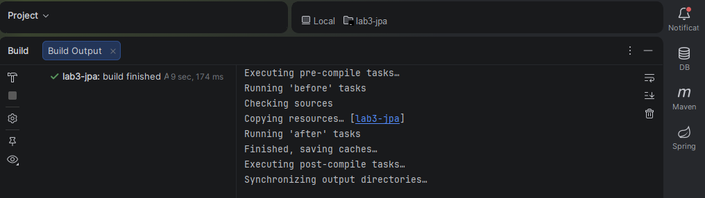

### 5. Lancement

```bash
./mvnw spring-boot:run
```

Ou bouton ▶ sur `Lab3JpaApplication` dans IntelliJ. L'API est disponible sur **http://localhost:8081**.

<!-- 📸 Capture : démarrage de l'application -->


---

## Endpoints et droits d'accès

| Méthode | Endpoint | USER | MANAGER | ADMIN | Public |
|---|---|:-:|:-:|:-:|:-:|
| POST | `/api/auth/register` | | | | ✅ |
| POST | `/api/auth/login` | | | | ✅ |
| POST | `/api/auth/refresh` | | | | ✅ (token valide requis) |
| GET | `/api/products`, `/api/products/{id}` | ✅ | ✅ | ✅ | |
| POST | `/api/products` | ❌ | ✅ | ✅ | |
| PUT / DELETE | `/api/products/{id}` | ❌ | ❌ | ✅ | |
| GET / POST / PUT / DELETE | `/api/categories/**` | ❌ | ❌ | ✅ | |
| GET | `/api/orders` | ses commandes | toutes | toutes | |
| GET | `/api/orders/{id}` | la sienne | ✅ | ✅ | |
| POST | `/api/orders` | ✅ | ❌ | ❌ | |
| DELETE | `/api/orders/{id}` | ❌ | ❌ | ✅ | |

Toutes les routes protégées attendent le header : `Authorization: Bearer <token>`.

**Codes d'erreur :**
- `401 Unauthorized` : identifiants invalides au login (« Invalid username or password »)
- `403 Forbidden` : rôle insuffisant (« Access denied: insufficient permissions ») ou token absent/invalide

---

## Réalisation pas à pas

| Étape | Contenu | Fichiers |
|---|---|---|
| 1-2 | Prérequis et reprise du projet LAB 3 | — |
| 3 | Dépendances Spring Security et JJWT | `pom.xml` |
| 4 | Entité `User` et table `users` | `entity/User.java`, `db/lab4-security.sql` |
| 5 | Repository et `UserDetailsService` | `UserRepository`, `CustomUserDetailsService` |
| 6 | Hachage BCrypt | `config/PasswordConfig.java` |
| 7 | Utilitaire JWT (génération, validation) | `security/JwtUtil.java` |
| 8 | Filtre d'authentification JWT | `security/JwtAuthenticationFilter.java` |
| 9 | `SecurityFilterChain` (stateless, règles d'accès) | `config/SecurityConfig.java` |
| 10 | Endpoint d'inscription | `AuthController`, `RegisterRequest` |
| 11 | Endpoint de connexion et génération du JWT | `AuthController`, `LoginRequest`, `JwtResponse` |
| 12 | Produits protégés par `@PreAuthorize` | `ProductController` |
| 13 | Catégories réservées aux ADMIN | `CategoryController`, `CategoryService` |
| 14 | Commandes : logique USER vs ADMIN | `Order` (champ `user`), `OrderRepository`, `OrderService`, `OrderController` |
| 15 | CORS et désactivation du CSRF | `SecurityConfig` |
| 16 | Gestion des erreurs 401 / 403 | `exception/GlobalExceptionHandler.java` |
| 17 | Tests Postman | `postman/` |
| 18 | Diagrammes UML | `docs/uml/` |
| 19 | Exercices (MANAGER, refresh, révocation) | voir [Exercices](#exercices) |

### Adaptations par rapport à l'énoncé

- Le code du LAB 3 a été regroupé dans le package unique `com.example.shop`.
- Les contrôleurs conservent les DTO et la pagination du LAB 3 ; les règles `@PreAuthorize` du labo y ont été ajoutées.
- Chaque commande est liée à son propriétaire (`orders.user_id`) : un USER ne voit que ses propres commandes.
- `POST /api/orders` reçoit `{"productIds": [...]}` ; un id répété augmente la quantité.

---

## Tests Postman

### Configuration

Environnement Postman **LAB4 - Auth** :

| Variable | Valeur |
|---|---|
| `baseUrl` | `http://localhost:8081` |
| `tokenUser`, `tokenAdmin`, `tokenManager` | remplies automatiquement par les requêtes de login |
| `orderId` | rempli automatiquement par « Orders → Create (USER) » |

Exemple de script de login (onglet *Scripts → Post-response*) :

```javascript
pm.test("Login USER : statut 200", () => pm.response.to.have.status(200));
pm.environment.set("tokenUser", pm.response.json().token);
```

Import : Postman → **Import** → `postman/Lab4-Auth.postman_collection.json`.

### 1. Inscription — `POST /api/auth/register`

```json
{ "username": "alice", "email": "alice@mail.com", "password": "1234", "role": "USER" }
```

<!-- 📸 Capture : register -->
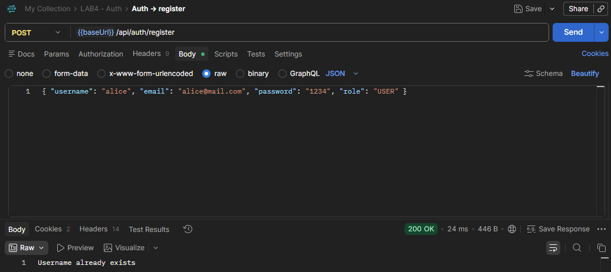

### 2. Connexion USER — `POST /api/auth/login` → 200 + token

```json
{ "username": "alice", "password": "1234" }
```

<!-- 📸 Capture : login USER -->
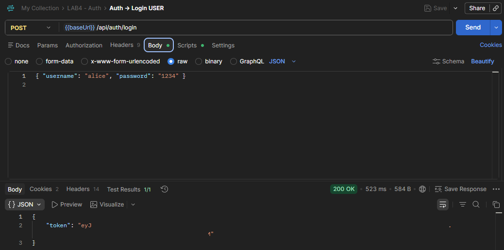

### 3. Liste des produits (USER) — `GET /api/products` → 200

<!-- 📸 Capture : products get all -->
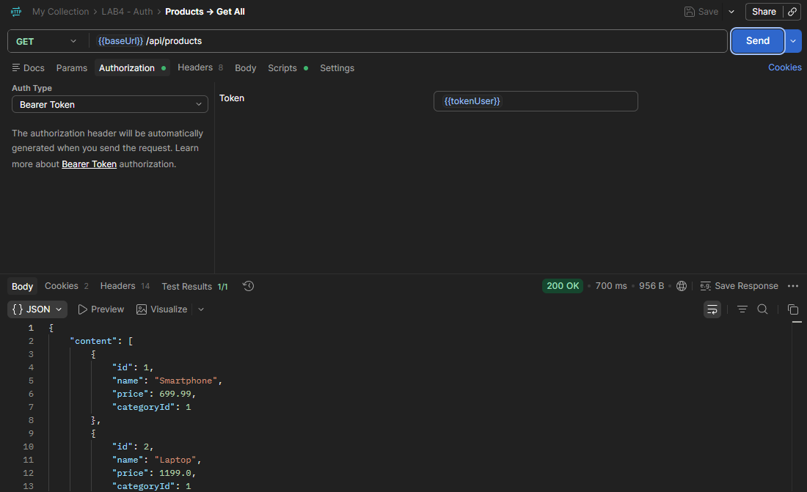

### 4. Mes commandes (USER) — `GET /api/orders` → 200

<!-- 📸 Capture : my orders -->
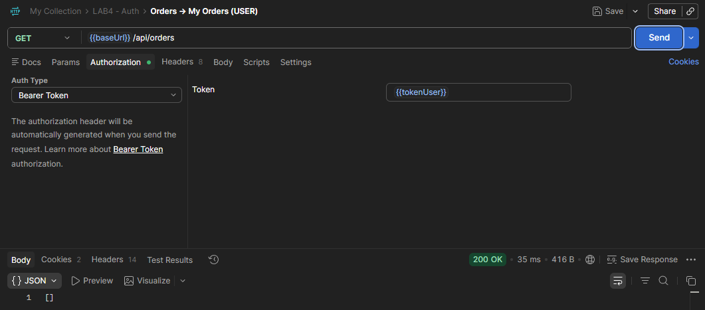

### 5. Suppression d'une commande par un USER — `DELETE /api/orders/{{orderId}}` → 403

<!-- 📸 Capture : delete USER refusé -->
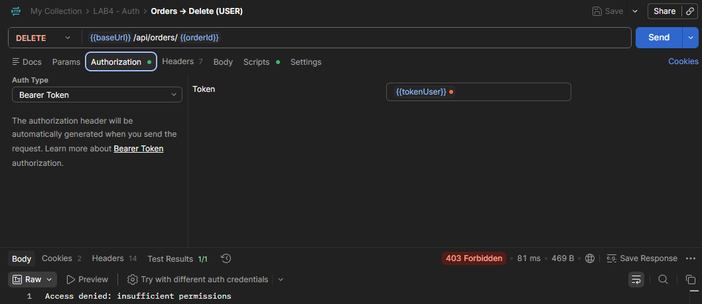

### Récapitulatif des tests

| # | Requête | Token | Attendu |
|---|---|---|---|
| 1 | Register USER / ADMIN / MANAGER | — | 200 |
| 2 | Login USER / ADMIN / MANAGER | — | 200 |
| 3 | Login mauvais mot de passe | — | 401 |
| 4 | Products → Get All | USER | 200 |
| 5 | Products → Create | ADMIN | 201 |
| 6 | Products → Create | USER | 403 |
| 7 | Orders → Create | USER | 201 |
| 8 | Orders → My Orders | USER | 200 |
| 9 | Orders → Delete | USER | 403 |
| 10 | Orders → Delete | ADMIN | 204 |

---

## Exercices

### Exercice 1 — Rôle MANAGER

Le MANAGER peut lire toutes les commandes et créer des produits, mais pas les modifier ni les supprimer.

- `SecurityConfig` : `MANAGER` ajouté aux règles `/api/products/**` et `/api/orders/**`
- `ProductController` : `create` → `hasAnyRole('ADMIN','MANAGER')`, `update`/`delete` restent `hasRole('ADMIN')`
- `OrderController` : `list` et `get` accessibles au MANAGER, qui voit toutes les commandes

**Connexion MANAGER :**

<!-- 📸 Capture : login MANAGER -->
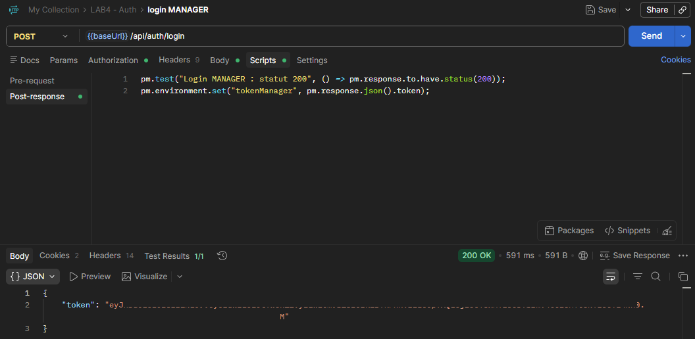

**Toutes les commandes (MANAGER) — `GET /api/orders` → 200 :**

<!-- 📸 Capture : orders MANAGER -->
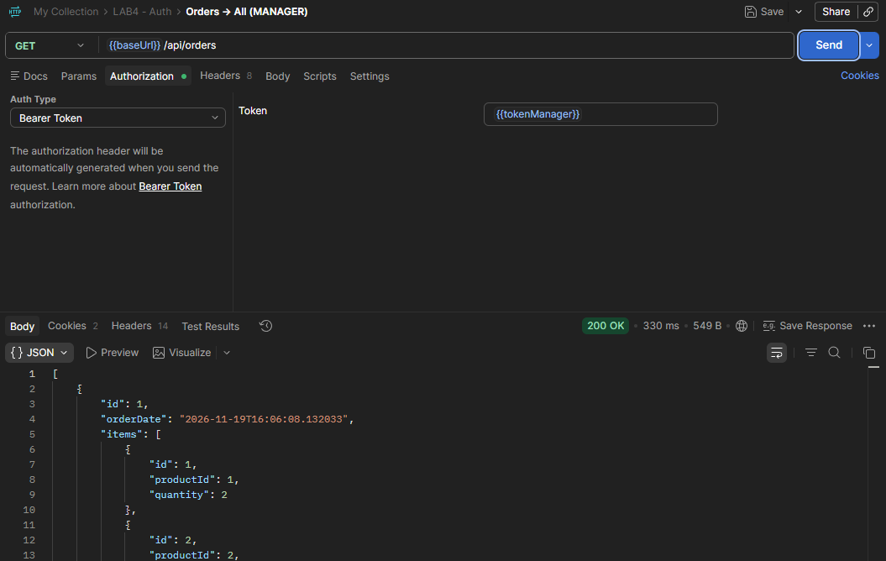

### Exercice 2 — Rafraîchissement du token

`POST /api/auth/refresh` avec un token valide dans le header `Authorization` renvoie un nouveau token (nouvelle durée de 24 h). `JwtUtil.extractRole()` permet de conserver le rôle.

<!-- 📸 Capture : refresh token -->
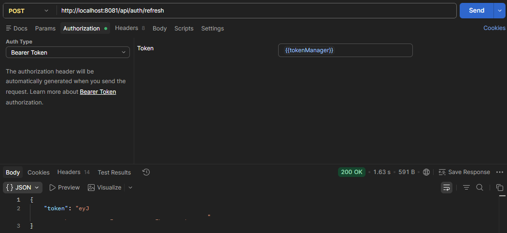

### Exercice 3 — Stratégie de révocation des JWT

Un JWT est autoporteur : une fois émis, il reste valide jusqu'à son expiration. Stratégie proposée, combinant trois mécanismes :

1. **Durée de vie courte** : réduire l'expiration du token d'accès (par exemple 15 minutes) et utiliser `/api/auth/refresh`. Un token volé n'est exploitable que peu de temps.
2. **Liste noire en base** : une table `revoked_tokens (token, expires_at)` reçoit les tokens révoqués (déconnexion, compte compromis). `JwtAuthenticationFilter` refuse tout token présent dans cette table. Les lignes expirées sont purgées régulièrement par une tâche planifiée.
3. **Rotation du secret** : en cas de fuite du secret de signature, le changer invalide immédiatement tous les tokens émis. Le secret est externalisé (variable d'environnement ou coffre-fort), jamais écrit en dur dans le code.

---

## Diagrammes UML

### Séquence d'authentification

Client → AuthController (`POST /login`) → AuthenticationManager → UserDetailsService → AuthController → JwtUtil → Client (token JWT)

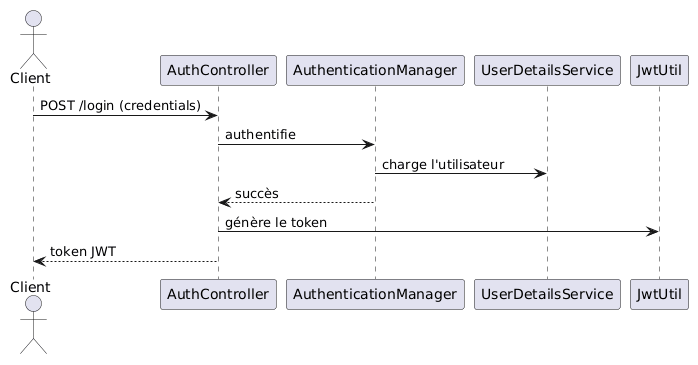

### Chaîne de filtres Spring Security

Client → JwtAuthenticationFilter → SecurityContextHolder (Authentication) → DispatcherServlet → contrôleur ciblé

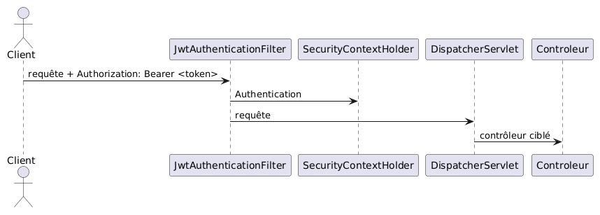

---

## Livrables

- [x] Code source complet (package `com.example.shop`)
- [x] Script SQL : `src/main/resources/db/lab4-security.sql`
- [x] Collection Postman : `postman/Lab4-Auth.postman_collection.json`
- [x] README avec instructions de build, d'exécution et de tests
- [x] Diagrammes UML : `docs/uml/`

---

## Bonnes pratiques et limites

- Mots de passe hachés avec **BCrypt**, jamais stockés en clair.
- API **stateless** : aucune session serveur, CSRF désactivé.
- **CORS** limité à `http://localhost:3000` et `http://127.0.0.1:5500`.
- En production : externaliser le secret JWT (`JwtUtil` contient un secret de démonstration), restreindre les origines CORS, activer SSL pour MySQL et empêcher l'auto-attribution du rôle ADMIN à l'inscription.
